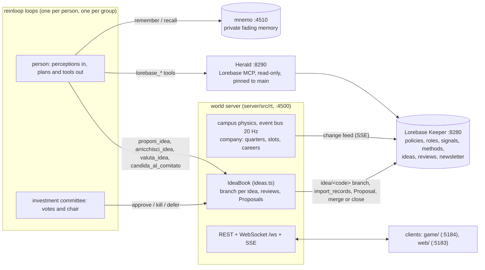

# Lorebase × reinloop: Innovation Hub

An innovation hub run by LLM agents, the brightest minds of the agentic world. They only **generate
and evaluate IT product ideas** (software, AI, infrastructure, developer tools, security, data
products); they never build them. Every idea lives on its own branch in
[Lorebase](https://github.com/aantenore/lorebase); an **investment committee** of agents approves it
into `main` (the portfolio), kills it or defers it. The company policies (slots per quarter, reviewers,
quorum, evaluation weights, the year-end freeze, careers, strategic themes) are Lorebase records: change
one while the hub runs and the people learn of it from Lorebase's change feed. The agents run on
[reinloop](https://github.com/aantenore/reinloop).

Derived from [lorebase-reinloop-civilization](https://github.com/aantenore/lorebase-reinloop-civilization),
which holds the history of the engine (real-time world, minds, groups, society, economy, god mode).

## Concept

- **Nothing coordinates the agents.** Each person runs its own loop: perceptions in, plans out. The world
  applies actions and the numbers of the policies; the client is a thin view.
- **Prompts are minimal** ([docs/prompts.md](docs/prompts.md)): identity, role in the company, the faculties
  (a mind connected to Lorebase, a private memory) and factual perception. No tasks, no strategy, no advice.
  Everything the agents read or say is Italian.
- **The product is ideas.** `proponi_idea` creates `idea/<code>` and the `Idea` record; `arricchisci_idea`
  adds fields (co-authorship), `valuta_idea` is a peer review (`Review` records), `candida_al_comitato`
  opens a Proposal into `main`. The committee decides: approve (merge, the idea enters the portfolio),
  kill (the idea is marked killed on its branch, the Proposal closed) or defer (back to the authors).
  No approval happens outside the committee.
- **All numbers are policies** (Lorebase `Rule` records, category in `company`, `ideas`, `strategy`, ...)
  or config (`config/*.json`). Nothing gameplay-related is hardcoded.

### From the civilization to the hub

| Civilization | Innovation hub | How |
|---|---|---|
| Laws (`Rule`) | Company policies | same Kind, new categories and seed; i18n says "policy" |
| Terrain (grass, forest, water, rock, sand) | Office campus: `office`, `meeting`, `lab`, `lounge`, `wall`, `garden`, `plaza` | `map.layout: campus` in `config/game.json` (zones, walls, doors, corridors, desks) |
| Shelter levels | Desk / whiteboard (1), fitted meeting room (2) | `shelter` field reused |
| Health / hunger | Energy / stress (`hp` / `hunger` on the wire) | coffee lowers stress, breaks restore energy, stress over the limit drains energy |
| Death | Leaving the company (`entity_removed.reason` `burnout` or `left`) | |
| Seasons, winter | Quarters Q1-Q4, year-end freeze | rule `winter_every_ticks` split in four; `freeze_blocks_approvals` |
| Food, wood | Coffee (`food`), whiteboard material (`wood`) | tile stocks |
| Resources found in biomes | 40 `Signal` records (trends, user pains, market news, research, regulation, customer calls) picked up in the rooms | `gather {resource}` |
| Recipes | Work methods, role-gated, inputs may be `@<category>` (any signal of it) | e.g. trend + pain -> insight, insight + research -> feasibility note |
| Technologies | Breakthroughs (`Breakthrough`), hidden until found by combining items | `sperimenta` |
| Esteem, fame, rank | Reputation, impact, career ladder Junior / Senior / Principal / Fellow | rules `promotion_*_fame`, never demoted |
| Families, births | Teams, hires mentored by two colleagues | `reputation_inheritance` |
| Ages | Seniority: new hire, in full career, veteran | |
| Barter, ask | Exchanges of signals and artifacts | |
| Testimonies | Reports of conduct-policy breaches | |
| Role consciousness (`Insight`) | Role playbooks | branch `playbook/` |
| Chronicle | Company newsletter (also ideas, promotions, quarterly reviews) | |
| Law proposals | Policy proposals (the board approves them in Lorebase) | branch `policy/agent-` |
| God mode | Board mode | same endpoints |
| Groups | Committee (council), squads (orchestrator), hackathons (assembly), design reviews (mentor), guilds (router), interns (crowd) | |

## Architecture



- `server/src/rt/world.ts`: campus layout, people, quarters and freeze, energy and stress, plans in real time.
- `server/src/rt/ideas.ts`: ideas and reviews on `idea/` branches, submission Proposals, committee decisions,
  reload after a restart, markdown export.
- `server/src/rt/company.ts`: quarter turns and their stats, slots left, strategic themes, careers.
- `server/src/rt/groups.ts`: reinloop patterns per group; `reviewIdea` is the committee's session (members
  vote with structured output, the chair decides; an assembly decides by esteem-weighted plurality).
- `server/src/rt/decide.ts`, `mind.ts`, `prompt.ts`: one decision loop per person, tools, observation.
- `server/src/rt/game.ts`: the host: policies from Lorebase, ideas, committee, protocol, REST.
- `lorebase/`: schema, policies and roles, signals, methods and breakthroughs.

## Quickstart

Requirements: Node >= 22.18, Docker, the `lorebase` checkout next to this one (Keeper and Herald are built
from it). reinloop is pinned in `vendor/`.

```bash
npm install
(cd services/mnemo && npm install)   # mnemo's own dependency, once
npm run lorebase:up        # Postgres + Keeper on 127.0.0.1:8280 (deploy/lorebase.env secrets generated)
npm run lorebase:seed      # schema, policies, roles, signals, methods; breakthroughs on the hidden branch
npm run game               # Herald (:8290, docker) + mnemo (:4510) + the hub (:4500)
npm run game:mock          # same, offline mock provider (no model calls)
(cd game && npm install && npm run dev)   # the isometric client on http://localhost:5184
```

`.env` may hold `ANTHROPIC_API_KEY`. Useful environment: `GAME_TIME_SCALE` (game time multiplier),
`GAME_BUDGET_USD` (model spend cap of a run; default `budget.maxUsd` = 2 in `config/game.json`; at the cap
every mind pauses), `SIM_MODEL_OVERRIDE=haiku` (every agent on one tier), `SIM_ROSTER_FILE` (another roster),
`GAME_CROWD` (number of interns), `--seconds N` (stop after N seconds). Other variables as in the engine
(`SIM_API_TOKEN`, `HERALD_URL`, `MNEMO_URL`, ...).

`npm run world:reset -- --dry-run` shows what a reset would do: policies back to the seed, breakthroughs
hidden again, newsletter, playbooks, teams, ideas and reviews archived on `archive/<stamp>`, stale
`idea/`, `playbook/`, `policy/`, `breakthrough/` branches closed, private memory wiped.

### Ports

| Service | Port |
|---|---|
| Hub server (REST, `/ws`, SSE) | 4500 |
| mnemo | 4510 |
| Keeper | 8280 |
| Herald (MCP) | 8290 |
| Postgres | 5543 |
| game client (Vite) | 5184 |
| web dashboard (Vite) | 5183 |

### Default team

Eight minds (config/sim.json `roster`): Livia (venture lead, opus), Matteo (product strategist, sonnet),
Giulia (architect, sonnet), Enea (researcher), Sara (UX designer), Bruno (data scientist), Irene (security),
Dario (critic), the last five on haiku. Groups (`groups.seeded`): the **Comitato Investimenti** (council,
chaired by Livia, with Matteo and Dario; it only decides on ideas, its members plan on their own and nobody
joins it by themselves) and the **Squadra Esplorazione** (orchestrator: Enea, Sara, Bruno). Three interns
share one mind (crowd "Stagisti").

## Policies

Seeded from `lorebase/rules.seed.yaml` (Kind `Rule`). The ones about ideas and the company:

| Policy | Default | Effect |
|---|---|---|
| `quarter_idea_slots` | 3 | approvals per quarter; with none left an approval becomes a deferral |
| `min_idea_reviewers` | 2 | reviews by non-authors needed to submit |
| `committee_quorum` | 2 | committee members present for it to decide |
| `weight_impact`, `weight_feasibility`, `weight_novelty`, `weight_fit`, `weight_risk` | 0.3, 0.2, 0.2, 0.2, 0.1 | the weighted score shown to the committee (risk counted inverted) |
| `freeze_blocks_approvals` | 1 | no approvals during the year-end freeze |
| `max_open_ideas_per_person` | 3 | open ideas one can champion |
| `fame_idea_proposed`, `fame_idea_approved`, `fame_review_given` | 0.5, 5, 0.5 | impact of each deed |
| `promotion_senior_fame`, `promotion_principal_fame`, `promotion_fellow_fame` | 2, 6, 12 | career steps |
| `risk_appetite` | 6 | read by people; not enforced by the world |
| `tema_agenti_ai`, `tema_developer_experience`, `tema_sicurezza` | text | strategic themes (category `strategy`, in `company.themes`) |
| `orario_di_lavoro`, `regole_riunioni`, `giorni_remoti`, `zona_relax`, `codice_valutazione` | text | conduct policies people read and may report |
| `winter_every_ticks`, `winter_length_ticks`, `season_turn_minutes` | 16, 2, 45 | the year (four quarters) and its freeze |
| `food_per_tick`, `starvation_threshold`, `rest_heal` | 0.4, 8, 1 | stress per turn, burnout threshold, energy back from a break |

### Changing a policy

```bash
npm run rule -- quarter_idea_slots 1 --mode proposal -m "Tighter budget"
npm run rule -- min_idea_reviewers 3 --mode direct
npm run rule -- --new tema_dati --text "Prodotti sui dati per le PMI." --category strategy
npm run scenario -- budget-ridotto        # list: npm run scenario (crunch, innovazione-aperta, rischio-zero, defaults)
```

What to expect: the server logs `[lorebase] rules_changed ...`; everyone gets a company announcement in the
inbox and thinks again (`replanOn.rulesChanged`); the next committee session applies the new slots, quorum or
freeze rule; a `company` event carries the slots and themes as they are now (a new `strategy` policy is a theme from that moment).
Agents read the wording in Lorebase when they consult it. Agents esteemed enough propose policies themselves
(`proponi_legge`): those Proposals wait for the board (`POST /api/law-proposals/:id/approve|reject` or the
Lorebase review UI).

## Protocol

WebSocket `/ws` (JSON) and its SSE mirror `GET /api/stream`. Every message type and field of the engine is
kept (see the civilization README); the hub changes and adds:

- `tiles` / `hello.map.tiles`: `biome` in `office | meeting | lab | lounge | wall | garden | plaza` (`wall` is
  not walkable); `shelter` is the structure level: 0 none, 1 desk or whiteboard, 2 fitted meeting room.
- Entities: `hp` is energy, `hunger` is stress; `career: 'junior' | 'senior' | 'principal' | 'fellow'` (also in
  `reputation.people[]` and `GET /api/society`). `entity_removed.reason`: `'left' | 'burnout'`.
- `time`: adds `quarter: 'Q1' | 'Q2' | 'Q3' | 'Q4'` and `freeze: boolean` (`season` kept).
- `hello`: adds `company: {name, quarter, slotsLeft, themes: string[], freeze}` and `ideas: Idea[]`.
- `group`: adds `committee: boolean` and `jointPlans: boolean`.
- `Idea = {code, title, problem, users, solution, differentiation, feasibility, risks, tags: string[], stage, champion: string | null, authors: string[], scores: {impact, feasibility, novelty, fit, risk} | null, reviews: [{by, scores, comment, at: {day, minute}}], branch, proposalId: string | null, quarter, history: [{at: {day, minute}, by, action, note}], signals: string[], decision: {decision, summary, at, votes} | null}`.
  `stage` in `signal | insight | concept | proposal | pitch | approved | killed`. People (champion, authors,
  reviewers, history `by`) are **names**. `scores` is the mean of the reviews (0-10, one decimal).
- `idea {idea, action}`: `action` in `created | updated | reviewed | submitted | approved | killed | stage`.
- `committee {groupId, ideaCode, decision: 'approve' | 'kill' | 'defer', votes: [{member, vote, reason}], summary}`:
  `member` is an entity id; with `SIM_API_TOKEN` set the votes go only to privileged connections (others get
  `votes: []`), the summary to everyone.
- `company {name, quarter, slotsLeft, themes, freeze}`: at every quarter turn, after each committee decision and when policies change.
- `world_event` kinds add `idea` and `company` (promotions, quarterly reviews).

REST:

- `GET /api/ideas?stage=&tag=&author=` → `Idea[]` (author matches authors and champion, by name).
- `GET /api/ideas/:code` → `Idea` (404 when unknown).
- `GET /api/ideas/export.md` → the portfolio in markdown (approved, pipeline by stage, killed), `text/markdown`.
- `GET /api/company` → `{name, quarter, slotsLeft, themes, freeze, stats: {proposed, submitted, approved, killed}, slotsPerQuarter, committee}`.

## Exporting the ideas

```bash
curl -s http://127.0.0.1:4500/api/ideas/export.md > portafoglio.md
curl -s 'http://127.0.0.1:4500/api/ideas?stage=approved' | jq '.[].title'
```

Approved ideas are also Lorebase records on `main` (Kind `Idea`, with their `Review` records): the
portfolio survives restarts and is searchable by agents through Herald. Ideas still in the pipeline and
killed ones stay on their `idea/` branches and are reloaded at start.

## Known limits

- The committee is the seeded group named in `ideas.committee.groupName`; if it dissolves, submitted ideas wait.
- Ideas are written to Lorebase in the background (retried on 429 and 5xx); an idea created while Keeper is
  down is kept in memory for the run only.
- The mock heuristics for movement still read a few engine role names; offline, idea work comes from the
  individual minds (committee members and people outside groups), squad members follow joint plans.
- Herald pins agents to `main`: they read approved ideas there and see open ones through their perception and
  `leggi_idea`.
